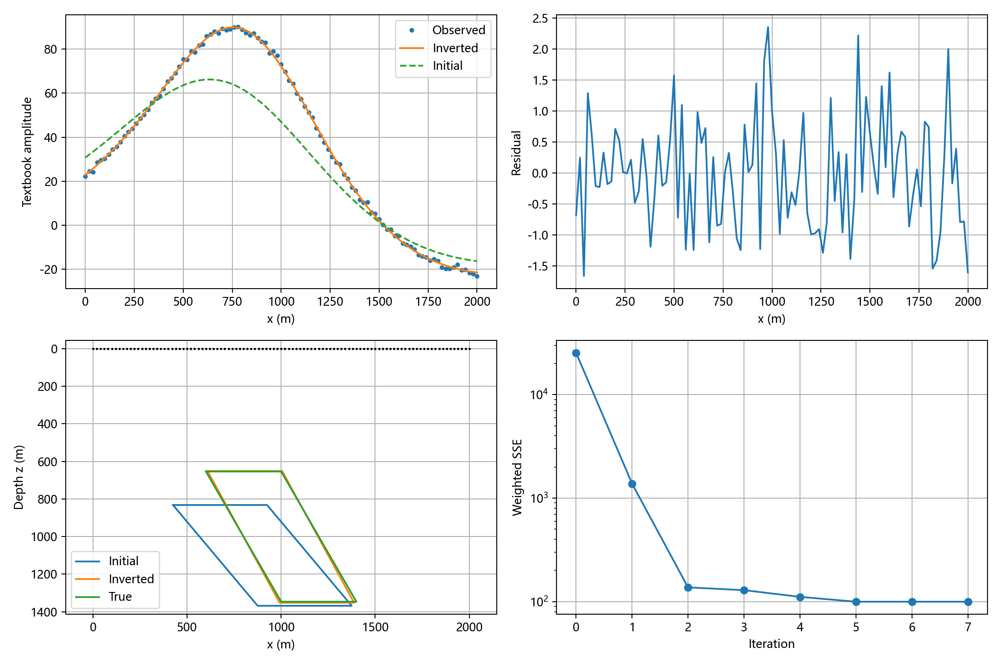

# 二维板磁异常阻尼最小二乘反演

有限延深二维倾斜板模型的磁异常反演，提供 **MATLAB** 与 **Python** 两套独立实现。

本实验承接仓库中的[二维板正演实验](https://github.com/SeisLynx/Textbook-Basis-of-geophysical-inversion/tree/main/%E4%BA%8C%E7%BB%B4%E6%9D%BF%E6%AD%A3%E6%BC%94)，根据地表磁异常剖面估计地下板体的位置、尺寸与倾角。算法对应课程课件中的 **XASU、DETU、QF、MAQT**，显式实现数值雅可比、法方程规格化、Cholesky 求解及自适应阻尼，便于逐步讲解和修改。

## 功能简介

- 正演生成合成观测，加入可调高斯噪声，开展模型恢复实验。
- 从 CSV 读取实测异常，支持不等间距测点和不同测点高度。
- 指定自由参数，开展五参数几何反演或七参数反演。
- 绘制异常拟合、残差、地下板体剖面及目标函数迭代曲线。
- 保存模型参数、拟合数据和迭代历史，并提供可选数值验收脚本。

当前模型为沿走向无限延伸、剖面内有限延深的单个二维板状体，反演数据为**磁异常**。

## 文件结构

```text
.
├── README.md
├── two_dimensional_plate_inversion.m    # MATLAB 主程序，含全部子函数
├── two_dimensional_plate_inversion.py   # Python 主程序，可独立运行
├── requirements_inversion.txt          # Python 依赖
├── demo_observations.csv               # 固定的合成含噪声观测，101 个测点
├── verify_plate_inversion.py           # 可选验收脚本
└── figures/
    ├── inversion_python.png            # Python 默认实验结果
    └── inversion_matlab.png            # MATLAB 默认实验结果
```

**课堂只需运行所选语言的主程序。** `verify_plate_inversion.py` 用于检查数值实现，不需要先运行，也不参与主程序的反演计算。

## 环境要求

### MATLAB

- 已在 MATLAB R2022b 中运行验证。
- 无需 Optimization Toolbox 或第三方工具箱。

### Python

建议使用 Python 3.10 或更新版本，依赖 NumPy 与 Matplotlib：

```bash
python -m pip install -r requirements_inversion.txt
```

程序自行实现阻尼最小二乘迭代，不依赖 SciPy 优化器。请在运行主程序的**同一个 Python 环境**中安装依赖。

## 快速开始

下载本目录文件后，将工作目录切换到代码所在目录。

### MATLAB

```matlab
r = two_dimensional_plate_inversion;
```

程序自动生成含噪声观测并反演，结果保存在主程序同目录的 `inversion_results_matlab/`。

### Python

```bash
python two_dimensional_plate_inversion.py
```

也可以在 Spyder 中打开 `two_dimensional_plate_inversion.py`，按 **F5** 运行。结果保存在主程序同目录的 `inversion_results_python/`；在支持的交互后端中显示结果图，命令行运行时生成图片文件。

完整命令行参数可通过以下命令查看：

```bash
python two_dimensional_plate_inversion.py --help
```

## 模型参数与默认实验

参数顺序为：

```text
p = [x0, z0, 2b, 2L, alpha_deg, i_deg, M]
```

| 编号 | 参数 | 含义 | 真实值 | 迭代初值 | 默认处理 |
|---|---|---|---:|---:|---|
| 1 | `x0` | 板中心横坐标，m | 1000 | 900 | 反演 |
| 2 | `z0` | 板中心深度，m | 1000 | 1100 | 反演 |
| 3 | `2b` | 水平全宽，m | 400 | 500 | 反演 |
| 4 | `2L` | 沿倾斜侧边的全长，m | 800 | 700 | 反演 |
| 5 | `alpha_deg` | 板倾角，° | 60 | 50 | 反演 |
| 6 | `i_deg` | 有效磁化方向角，° | 60 | 60 | 固定 |
| 7 | `M` | 磁化幅度，单位取决于模式 | 2000 | 2000 | 固定 |

坐标约定：**x 向右为正，z 向下为正，地表为 z = 0**。板体的上、下边界水平，宽度是水平宽度。与正演实验中的半宽 `b`、半长 `L` 相比，本程序输入的是全宽 `2b`、全长 `2L`。

默认测线为 `0:20:2000 m`，共 101 个观测点。噪声为零均值高斯噪声，标准差等于无噪声信号绝对峰值的 **1%**。默认固定已知磁化方向和幅度，恢复前五个几何参数；实测反演时，应根据物性或地质资料设置这些先验值。

## 反演方法

目标函数为加权残差平方和：

$$
\Phi(\mathbf p)=\sum_{k=1}^{N}\left[\frac{g_k-f_k(\mathbf p)-B_0}{\sigma_k}\right]^2,
$$

其中，$g_k$ 为观测异常，$f_k$ 为模型正演异常，$B_0$ 为已知背景常数，$\sigma_k$ 为观测标准差。

| 模块 | MATLAB | Python | 作用 |
|---|---|---|---|
| 正演 | `XASU` | `xasu` | 计算给定模型的磁异常 |
| 雅可比 | `DETU` | `detu` | 用中心差分计算参数敏感度 |
| 目标函数 | `QF` | `qf` | 计算加权残差与平方和 |
| 阻尼迭代 | `MAQT` | `maqt` | 求参数增量并判断是否接受 |

每轮迭代按以下步骤执行：

1. 计算当前模型的正演异常和加权残差。
2. 对自由参数采用中心差分，建立雅可比矩阵。差分步长为 `1e-4 * max(abs(pj), 1)`。
3. 按观测标准差加权，再按雅可比列范数规格化。
4. 用 Cholesky 分解求解带阻尼的规格化法方程，并恢复物理参数增量。
5. 若试探模型满足几何约束且目标函数下降，接受模型，下一轮阻尼除以 10；否则保留当前模型，将阻尼乘以 10 后重试。
6. 根据目标函数变化、梯度、数值精度和迭代上限停止，保存结果。

设加权雅可比为 $J_w$，$D$ 的对角元为其各列范数，$J_s=J_wD^{-1}$，则求解：

$$
(J_s^\mathsf{T}J_s+\lambda I)y=J_s^\mathsf{T}r,
\qquad \Delta p=D^{-1}y.
$$

该形式对应原参数空间中的乘法型阻尼。阻尼用于稳定迭代步，不等同于加入地质先验的模型正则化。

## 默认反演结果

以下为 Python 默认合成含噪声实验结果：



四幅图依次表示异常拟合、残差、地下板体剖面对比和加权目标函数迭代过程。

| 几何参数 | 真实值 | 反演值 |
|---|---:|---:|
| `x0` / m | 1000 | 998.303 |
| `z0` / m | 1000 | 1001.364 |
| `2b` / m | 400 | 396.213 |
| `2L` / m | 800 | 798.347 |
| `alpha_deg` / ° | 60 | 61.371 |

本例固定 `i = 60°`、`M = 2000`，RMSE 约为 **0.8898（教材幅度）**。含噪声结果存在参数偏差；数值末位可能随运行环境略有变化。

[查看 MATLAB 默认实验结果](figures/inversion_matlab.png)。两种语言使用不同的随机数生成器，因此即使种子同为 2026，分别默认运行时生成的噪声也不同。比较两套实现时，应使用同一份观测数据。

## 使用同一份 CSV 数据

`demo_observations.csv` 是完整的合成含噪声示例，可供两种语言共同读取。

### MATLAB

```matlab
opts = struct( ...
    'initial', [900 1100 500 700 50 60 2000], ...
    'active', 1:5, ...
    'component', 'ppt', ...
    'unit', 'ppt', ...
    'background', 0);

r = two_dimensional_plate_inversion('demo_observations.csv', opts);
```

### Python

```bash
python two_dimensional_plate_inversion.py --data demo_observations.csv --initial 900 1100 500 700 50 60 2000 --active 1 2 3 4 5
```

固定参数保持为 `initial` 中的给定值。`active` 的用户输入在两种语言中均使用 **1—7 编号**；Python 程序内部会转换为从 0 开始的索引。

## 接入实测数据

CSV 第一行必须为表头，之后每行一个测点，按以下顺序提供三列或四列：

```csv
x_m,z_m,signal,std
0,0,22.2,1.0
20,0,24.5,1.0
40,0,24.1,1.0
```

上面仅展示格式，实际测点数必须大于自由参数数目。

- `x_m`：测点横坐标，m。
- `z_m`：测点深度坐标，向下为正，m；若输入资料为向上为正的高程，应先统一基准并转换符号。
- `signal`：完成背景及区域趋势处理后的异常信号。
- `std`：可选的观测标准差，必须为正且与信号同单位；省略时使用等权重 1。

将前面的示例文件名替换为自己的 CSV 即可。`background` 对应已知常数 $B_0$，目标函数中将其扣除，输出拟合曲线再加回。程序不自动估计区域趋势，也不计算地形或围岩本身的磁性贡献。

### 分量与单位

| 设置 | 含义 |
|---|---|
| `component='ppt'` | 默认，课程课件中 XASU 的标量磁异常约定 |
| `component='dx'` | 延续正演实验代码的水平分量 |
| `component='dz'` | 延续正演实验代码的垂直分量 |
| `component='dt'` | 延续正演实验代码沿磁化方向的总场投影 |
| `unit='ppt'` | 默认，直接输出公式数值，沿用教材幅度约定 |
| `unit='si'` | 假设 `M` 为 A/m，乘 `μ0 × 10^9` 后输出 nT |

`ppt` 的标量公式不应直接当作旧正演代码的 `dz` 或 `dt`。反演先前生成的数据时，应选择与原数据一致的分量和单位。`dt` 模式沿用磁化方向同时作为投影方向的假设。

例如，输入上一节正演得到的总场异常 **nT** 数据：

```matlab
opts.component = 'dt';
opts.unit = 'si';
r = two_dimensional_plate_inversion('observed_dt_nT.csv', opts);
```

```bash
python two_dimensional_plate_inversion.py --data observed_dt_nT.csv --component dt --unit si
```

`si` 模式下，`signal`、`std` 和 `background` 均应采用 nT。转换系数为 `mu0 * 1e9 = 4*pi*100`。请按实际导出数组确认单位，不要仅依赖曲线的纵轴标签。

## 实验设置示例

### 无噪声模型恢复

```matlab
opts = struct('noise', 0, 'out', fullfile(pwd, 'results_noiseless_matlab'));
r = two_dimensional_plate_inversion('', opts);
```

```bash
python two_dimensional_plate_inversion.py --noise 0 --out results_noiseless_python
```

### 七参数全部开放

```matlab
r = two_dimensional_plate_inversion('', struct('active', 1:7));
```

```bash
python two_dimensional_plate_inversion.py --active 1 2 3 4 5 6 7
```

也可固定磁化方向，反演几何与磁化幅度：MATLAB 设置 `active=[1:5 7]`，Python 使用 `--active 1 2 3 4 5 7`。

### 调整噪声或仅输出数值

```bash
python two_dimensional_plate_inversion.py --noise 0.05 --out results_noise_5pct
python two_dimensional_plate_inversion.py --no-plot
```

`noise` 表示合成噪声标准差相对于无噪声信号绝对峰值的比例，仅影响自动生成的合成观测。读取 CSV 时使用文件中的观测，不额外添加噪声。

## 输出文件

| 文件 | 内容 |
|---|---|
| `inversion.png` | 异常拟合、残差、模型剖面与迭代曲线 |
| `observations.csv` | 本次实际使用的坐标、观测和标准差 |
| `fit.csv` | 观测、预测与原始单位残差 |
| `history.csv` | 初始状态及各次成功更新的参数、目标函数和阻尼 |
| `result.json` | 最终参数、终止状态、RMSE 与规格化雅可比奇异值 |
| `result.mat` | MATLAB 变量与配置，仅 MATLAB 输出 |

同一输出目录再次运行时会覆盖上述同名结果；需要比较实验时，请设置不同的 `out`。

终止状态说明：

| `status` | 含义 |
|---|---|
| `relative_objective` | 目标函数相对改善已小于阈值 |
| `gradient_or_exact_fit` | 梯度足够小或达到近乎精确拟合 |
| `max_iter` | 达到最大迭代次数，应检查是否充分收敛 |
| `no_acceptable_step` | 未找到可接受的下降步骤，应检查初值与约束 |

`history.csv` 记录成功接受的模型，阻尼试探被拒绝时不增加成功更新记录。

## 数值验收（可选）

```bash
python verify_plate_inversion.py
```

验收内容包括四种分量在平坦和起伏测点上的无噪声几何恢复、目标函数下降、SI 单位换算、浅埋宽板的角度连续性及七参数拟合。

若主程序同目录存在完整的 `inversion_results_matlab/`，脚本会读取其中的 `observations.csv`、`fit.csv` 和 `result.json`，用 MATLAB 本次实际使用的数据和设置进行跨语言比较。没有 MATLAB 结果时，跳过跨语言检查，其余 Python 检查仍正常执行。结果写入 `verification_report.json`。

## 模型约束与解释范围

- 默认参数下界为 `[-2000, 10, 10, 10, 5, -89, 1]`，上界为 `[4000, 5000, 2500, 4000, 175, 89, 10000]`，按七参数顺序排列。
- 板顶必须满足 `z_top > max(z_obs) + 1 m`，即整个板体位于全部测点下方。
- 上述边界按课堂模型设置。实测尺度不同时，请调整 Python 中的 `LOW/HIGH` 或 MATLAB 中的 `valid_model`。
- 单一磁异常剖面存在多解性，尺寸、磁化方向与磁化幅度之间可能相互补偿。小残差不能证明地下形态唯一，七参数反演尤其需要先验约束。
- 本实验恢复的是预设单板模型的参数；应用于实际解释时，应结合地质、岩石物性或钻孔资料，并比较不同初值的结果。
